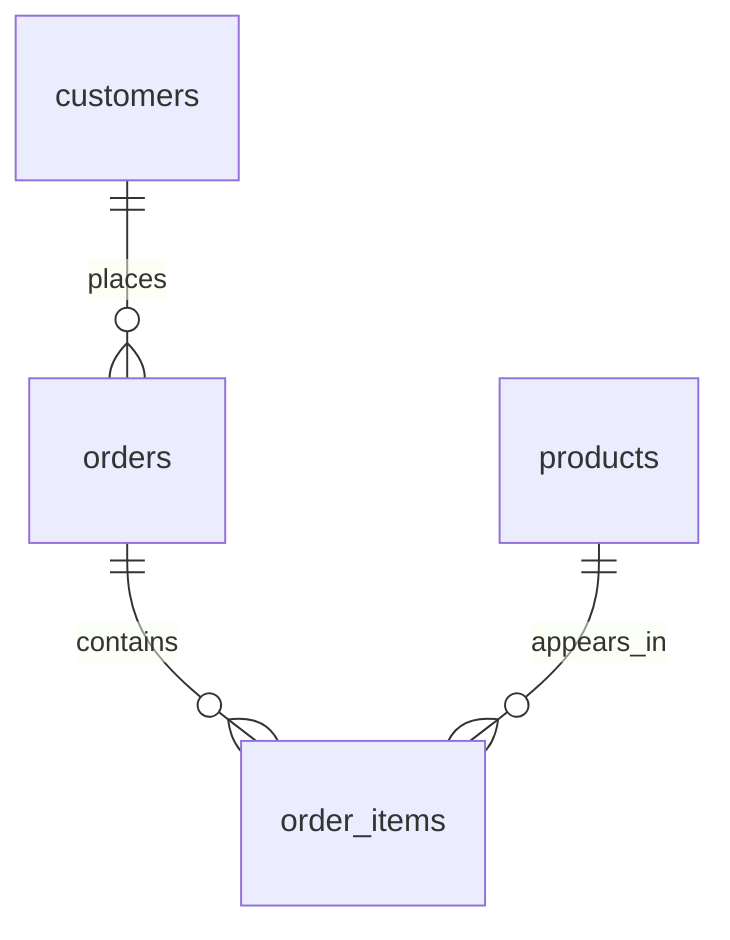

# Revenue Dataset

Dataset ID: `revenue`. Schema version: 1. Fixed as-of date: **2025-03-01**.
This independent dataset is shared by six revenue analytics exercises.

| Table | Columns |
| --- | --- |
| customers | id, name, region (nullable), joined_on |
| products | id, name, category |
| orders | id, customer_id -> customers.id, ordered_on, status, total_cents |
| order_items | id, order_id -> orders.id, product_id -> products.id, quantity, unit_price_cents |

All IDs are integer primary keys; foreign keys are enforced. Dates are calendar
dates without timezones. IDs do not establish chronology. Money is integer cents.
Customers may have no orders; products may be unsold. An order may have no items
or repeated lines for the same product. Zero-priced line items are valid purchases.

Revenue in this set is **quantity * unit_price_cents** on orders whose status is
`paid`, using `ordered_on`. `pending` and `refunded` orders do not contribute.
`orders.total_cents` is a separate declared amount and may differ from line-item
revenue. There are no payment or subscription tables in this dataset.

| Period | Included Start | Excluded End |
| --- | --- | --- |
| Current 90 completed days | 2024-12-01 | 2025-03-01 |
| Previous 90 completed days | 2024-09-02 | 2024-12-01 |
| 365 completed days | 2024-03-01 | 2025-03-01 |

These are half-open intervals: include the start date and exclude the end date.
The as-of day is not a completed day. Use the fixed dates, not the current clock.
Each exercise specifies which customers/products to include, ordering, and
zero/NULL/tie behavior.

The base data includes boundary dates, missing calendar months, older purchases,
excluded future orders, ties, and repeated line items. Explore it with one SELECT
in your generated answer file and `uv run sql-practice run`. Checking uses isolated
base, edge, empty and no-sales fixtures; do not hard-code sample IDs or totals.