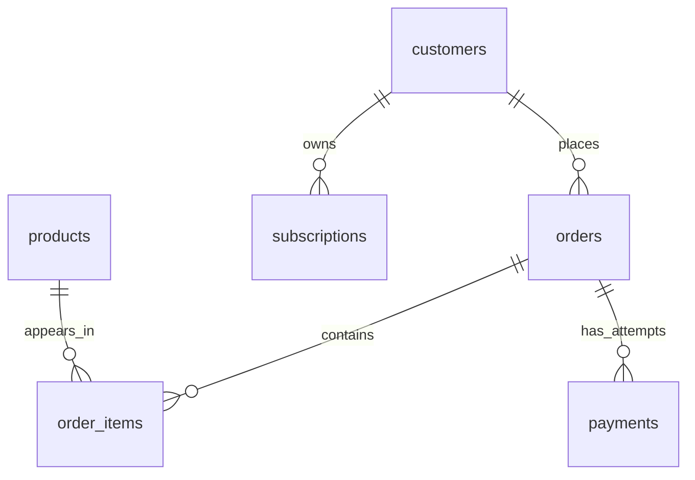

# Business Dataset

All IDs are integer primary keys. Foreign keys are enforced at load time. Money is
integer cents. Dates are calendar dates with no timezone; any future timestamp seeds
must use a documented UTC convention. Dataset version: 1. Fixed as-of: 2025-03-01.

| Table | Columns |
| --- | --- |
| customers | id, name, region (nullable), joined_on |
| products | id, name, category |
| orders | id, customer_id -> customers.id, ordered_on, status, total_cents |
| order_items | id, order_id -> orders.id, product_id -> products.id, quantity, unit_price_cents |
| payments | id, order_id -> orders.id, paid_on, status, amount_cents |
| subscriptions | id, customer_id -> customers.id, started_on, ended_on (nullable) |

Orders have status `paid`, `pending`, or `refunded`. Payments have status `succeeded`
or `failed`. A paid order can have several attempts or successful captures; its
declared total may not reconcile with captured payments. Payment dates and order
dates are different concepts. Revenue questions state which one to use.

Line-item revenue is `quantity * unit_price_cents`. Joining orders to both line items
and payments without first aggregating can multiply amounts. IDs are not chronology.

Subscriptions cover `[started_on, ended_on)`; NULL end means indefinitely active.
Customers can have several overlapping subscriptions. Products may be unsold;
customers may have no orders. Text comparisons in this bank use consistently cased
ASCII categories/statuses; case/collation portability is not assumed generally.

Explore the persistent base data using one SELECT in your generated answer file and
`uv run sql-practice run`. Checking uses additional isolated data; do not hard-code
the displayed sample IDs, totals, or dates unless a prompt explicitly supplies them.